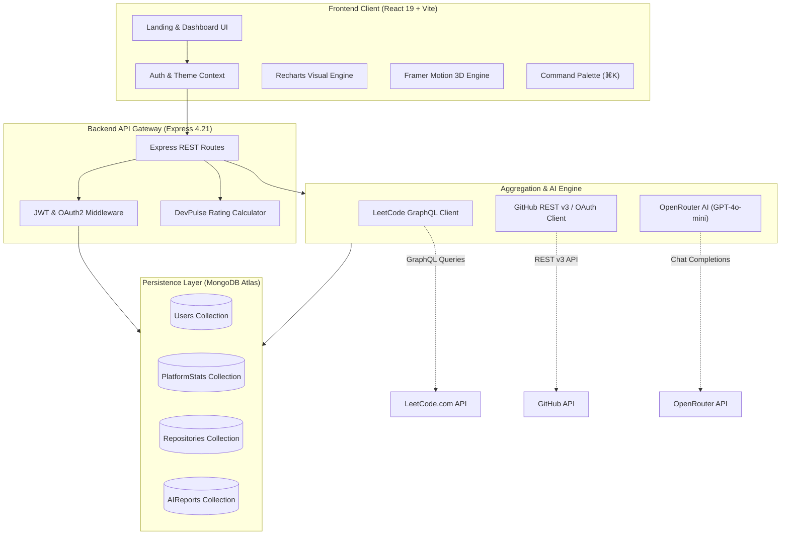

<div align="center">

# ⚡ DevPulse — Developer Intelligence Platform

> **"Your coding journey. One intelligent dashboard."**

A full-stack, enterprise-grade developer telemetry and intelligence hub that aggregates coding velocity across **GitHub, LeetCode, CodeChef, HackerRank, GeeksforGeeks, and AtCoder**. Built with the MERN stack, React 19, Tailwind CSS, Framer Motion, and OpenRouter AI.

[](https://github.com/Umesh-369/DevPulse/blob/main/LICENSE)
[](https://github.com/Umesh-369/DevPulse/stargazers)
[](https://github.com/Umesh-369/DevPulse/network)
[](https://nodejs.org/)
[](https://react.dev/)
[](https://expressjs.com/)
[](https://www.mongodb.com/atlas)
[](https://tailwindcss.com/)
[](https://openrouter.ai/)

<br/>

[](https://github.com/Umesh-369/DevPulse)
[](https://github.com/Umesh-369/DevPulse/pulls)
[](https://prettier.io)

<br/>

[Explore Live Demo](http://localhost:5173) • [Report Bug](https://github.com/Umesh-369/DevPulse/issues) • [Request Feature](https://github.com/Umesh-369/DevPulse/issues)

<br/>

### 🖥️ Pixel-Accurate Dual Theme Previews

<table>
  <tr>
    <td align="center"><b>🌙 Cosmic Obsidian (Dark Mode)</b></td>
    <td align="center"><b>☀️ Warm Alabaster (Light Mode)</b></td>
  </tr>
  <tr>
    <td></td>
    <td></td>
  </tr>
  <tr>
    <td align="center"><b>💼 Verified Developer Profile (Dark)</b></td>
    <td align="center"><b>💼 Verified Developer Profile (Light)</b></td>
  </tr>
  <tr>
    <td></td>
    <td></td>
  </tr>
</table>

<br/>

<table>
  <tr>
    <td align="center"><b>🌌 Opportunity Cosmic Banner</b></td>
    <td align="center"><b>🏔️ Mountain Spire Auth Experience</b></td>
  </tr>
  <tr>
    <td></td>
    <td></td>
  </tr>
</table>

</div>

---

## 📑 Table of Contents

- [Vision & Problem Statement](#-vision--problem-statement)
- [Key Features](#-key-features)
  - [1. Visual Design & Dual Theme System](#1-visual-design--dual-theme-system)
  - [2. Multi-Platform Telemetry Aggregation](#2-multi-platform-telemetry-aggregation)
  - [3. Interactive Landing Experience & Guided Tour](#3-interactive-landing-experience--guided-tour)
  - [4. Dynamic Unified Dashboard](#4-dynamic-unified-dashboard)
  - [5. Dynamic Verified Developer Portfolio](#5-dynamic-verified-developer-portfolio)
  - [6. Real-Time College & Peer Leaderboards](#6-real-time-college--peer-leaderboards)
  - [7. AI Career Coach & Skill Gap Radar](#7-ai-career-coach--skill-gap-radar)
  - [8. Developer Utility Suite (Problems, Repos, Goals, ⌘K)](#8-developer-utility-suite)
- [System Architecture](#-system-architecture)
- [Rating & Ranking Algorithm](#-rating--ranking-algorithm)
- [Database Schema & Data Models](#-database-schema--data-models)
- [Keyboard Navigation & Command Palette](#-keyboard-navigation--command-palette)
- [Technology Stack](#-technology-stack)
- [Security & Compliance](#-security--compliance)
- [Repository Structure](#-repository-structure)
- [REST API Specification](#-rest-api-specification)
- [Getting Started & Installation](#-getting-started--installation)
- [Environment Variables](#-environment-variables)
- [Frequently Asked Questions (FAQ)](#-frequently-asked-questions-faq)
- [Project Roadmap](#-project-roadmap)
- [Contributing](#-contributing)
- [License & Author](#-license--author)

---

## 🎯 Vision & Problem Statement

Modern software engineers don't write code in just one place:
- **LeetCode & GeeksforGeeks** for algorithmic problem solving and interview preparation.
- **GitHub** for open source contributions, repositories, and pull requests.
- **CodeChef, HackerRank & AtCoder** for competitive programming contests and rating progression.
- **LinkedIn / Personal Portfolios** for career representation.

This fragmentation creates a **scattered developer footprint**. Engineers are forced to manually maintain separate links, explain disparate metrics to recruiters, and lack a unified overview of their trajectory.

### The DevPulse Solution
**DevPulse solves this fragmentation** by providing a centralized, automated intelligence platform:
1. **Zero-Friction Ingestion:** Single handle connection across 6 major platforms with live profile verification.
2. **Unified Metrics:** Normalizes difficulty ratings, commits, streaks, and repository stars into a unified **DevPulse Rating Score**.
3. **AI Career Intelligence:** Synthesizes multi-platform telemetry with OpenRouter (GPT-4o-mini) to identify blind spots and construct actionable 7-day checklists.
4. **Verifiable Public Identity:** Produces a high-conversion, shareable portfolio (`/u/:username`) with instant GitHub import and dynamic CRUD project showcases.

---

## 🌟 Key Features

### 1. Visual Design & Dual Theme System
- **Warm Alabaster Light Mode (`#FAF8F5`)**: Natural paper tones, subtle cream borders, warm gold ochre accents (`#DFA048`).
- **Cosmic Obsidian Dark Mode (`#0B0D11` / `#151922`)**: Deep space blacks, midnight blue card layers, luminescent amber highlights (`#E5A952`).
- **Editorial Typography**: Premium serif accents (`Playfair Display`), impactful condensed headers (`Plus Jakarta Sans`), and ultra-legible body typography (`Inter`).
- **3D Interactive Parallax**: Mouse-reactive 3D perspective tilts on the hero showcase with floating metric tokens and `+42% Growth` indicators.

### 2. Multi-Platform Telemetry Aggregation
DevPulse connects with 6 platforms:
- **LeetCode**: GraphQL-based live stats fetching total solved, difficulty breakdown (Easy/Medium/Hard), acceptance rate, submission calendar, and active streak calculation.
- **GitHub**: REST v3 / OAuth integration pulling up to 100 repositories, star counts, fork counters, language distributions, and contribution estimates.
- **CodeChef**: Real-time division, global rank, and contest rating ingestion.
- **HackerRank**: Skill badges, verified certificates, and problem completion counts.
- **GeeksforGeeks**: Coding score, articles published, and problem milestones.
- **AtCoder**: Contest performance history and competitive ranking tier.

### 3. Interactive Landing Experience & Guided Tour
- **Sticky Glassmorphic Header**: Blur-backed navigation with animated theme toggle and quick auth triggers.
- **Hero Section**: 3D laptop tilt container, live metrics counter bar (`4.9/5 Rating`, `50K+ Devs`, `100+ Campuses`).
- **Live Interactive Sandbox**: Prospective users can test feature cards, toggle charts, and preview data without an account.
- **Guided Interactive Tour Modal**: Step-by-step walkthrough explaining telemetry aggregation, analytics, and AI career tools.
- **Tiered Pricing System**: Student Free, Pro Developer, and Campus/College licenses with annual/monthly toggles.

### 4. Dynamic Unified Dashboard (`/dashboard`)
- **Dynamic Welcome & Status**: Personalized greeting based on local time and verified user data.
- **4 Real-Time KPI Cards**: Total Problems Solved, Current Streak, Repositories count, and Dynamic Badges.
- **12-Month Contribution Heatmap**: Visual GitHub/LeetCode unified activity squares with tooltip day inspections.
- **Language Distribution Donut Chart**: Recharts-powered interactive breakdown of top programming languages.
- **Problem Solving Trend Area Chart**: Visual velocity curves tracking monthly solved progress.

### 5. Dynamic Verified Developer Portfolio (`/portfolio` & `/u/:username`)
- **Full Custom Project CRUD**: Add custom projects with title, description, tags, demo URL, and GitHub repository links.
- **Auto-Synchronized GitHub Repos**: Automatically pulls user's real public GitHub repositories with live star and fork telemetry.
- **Dynamic Skill Tags**: Automatically extracted from repository languages and coding platform categories.
- **Verified Achievements Grid**: Earn automated milestone badges based on real solved counts, streak continuity, and repo thresholds.
- **Public Share Link**: Dedicated URL (`/u/:username`) for recruiters and peers.

### 6. Real-Time College & Peer Leaderboards (`/leaderboard`)
- **Strict MongoDB Isolation**: Automatically sanitizes demo/mock entries to maintain a legitimate leaderboard of real registered developers.
- **Normalized Rating Sorting**: Sorts contenders by calculated DevPulse Rating, solved volume, and active streak.
- **Dynamic Scope Filters**: Switch between **Global**, **My College**, and **Friends** tabs.
- **Side-by-Side Comparison Drawer**: Select any peer on the leaderboard to compare skill bars, problems solved, and repository velocity.
- **Coding Challenge Creator**: Create custom time-boxed challenges for friends and classmates.

### 7. AI Career Coach & Skill Gap Radar (`/ai-insights`)
- **Powered by OpenRouter & GPT-4o-mini**: Analyzes real user telemetry (top languages, repository complexity, LeetCode problem difficulty, active streaks).
- **Radial Score Gauge**: Computes overall developer readiness score (e.g. `82/100`) and percentile standing.
- **5-Pillar Skill Radar**: In-depth score analysis across:
  - *Data Structures*
  - *Algorithms*
  - *System Design*
  - *Web Development*
  - *Machine Learning / AI*
- **Interactive 7-Day Checklist Roadmap**: Actionable tasks grouped into milestones. Clicking tasks immediately toggles completion status and synchronizes state to MongoDB.
- **Dynamic Career Recommendations**: Curated high-impact actions (e.g., target specific medium DP problems, open source contributions).

### 8. Developer Utility Suite
- **Problems Tracker (`/problems`)**: Searchable and filterable problem bank categorized by difficulty (Easy, Medium, Hard) and platform.
- **Repositories Explorer (`/repositories`)**: GitHub repository showcase with stars, forks, language badges, and direct links.
- **Goals Tracker (`/goals`)**: Visual goal cards with progress meters, deadlines, and target values.
- **Global Command Palette (`⌘K` / `Ctrl+K`)**: Universal search modal for jumping between pages, toggling themes, or triggering actions.

---

## 🏗 System Architecture



---

## 🧮 Rating & Ranking Algorithm

DevPulse calculates an objective developer rating score using verified platform metrics:

$$\text{DevRating} = (8 \times E) + (18 \times M) + (35 \times H) + \min(S \times 5, 200) + \min(R \times 8, 250)$$

| Variable | Description | Weight Factor | Cap |
| :--- | :--- | :---: | :---: |
| **$E$** | Easy Problems Solved | $\times 8$ | None |
| **$M$** | Medium Problems Solved | $\times 18$ | None |
| **$H$** | Hard Problems Solved | $\times 35$ | None |
| **$S$** | Current Consecutive Streak (Days) | $\times 5$ | 200 pts (40 days) |
| **$R$** | Public GitHub Repositories | $\times 8$ | 250 pts (~31 repos) |

### Developer Rank Tiers

| Rank Badge | Rating Threshold | Problems Milestone | Accent Color |
| :--- | :---: | :---: | :---: |
| **Grandmaster** | $\ge 2400$ | $\ge 1000$ | `#EF4444` (Ruby Crimson) |
| **Master** | $\ge 2000$ | $\ge 500$ | `#F59E0B` (Amber Gold) |
| **Expert** | $\ge 1800$ | $\ge 250$ | `#8B5CF6` (Royal Violet) |
| **Specialist** | $\ge 1400$ | $\ge 100$ | `#3B82F6` (Electric Blue) |
| **Pupil** | $\ge 800$ | $\ge 10$ | `#10B981` (Emerald Green) |
| **Newbie** | $< 800$ | $< 10$ | `#6B7280` (Muted Slate) |

---

## 🗄 Database Schema & Data Models

DevPulse leverages typed Mongoose schemas designed for sub-millisecond retrieval and robust relational linkages:

### 1. `User` Schema
```typescript
interface IUser {
  name: string;
  email: string;
  password?: string;               // Bcrypt hash
  avatar?: string;
  role: string;                    // e.g. "Full Stack Engineer"
  college?: string;
  bio?: string;
  targetRole?: string;
  theme: 'dark' | 'light';
  connectedPlatforms: {
    github?: { handle: string; connected: boolean; verified: boolean; lastSynced: Date };
    leetcode?: { handle: string; connected: boolean; solved: number; easy: number; medium: number; hard: number };
    codechef?: { handle: string; rating: number };
    hackerrank?: { handle: string };
    gfg?: { handle: string; score: number };
    atcoder?: { handle: string; rating: number };
  };
  stats: {
    problemsSolved: number;
    currentStreak: number;
    totalRepositories: number;
    rating: number;
  };
  projects: Array<IProject>;
  openRouterApiKey?: string;
}
```

### 2. `PlatformStats` Schema
Captures raw, platform-specific JSON payloads to permit decoupled offline caching and historical charting without re-requesting upstream APIs.

### 3. `AIReport` Schema
Stores historical snapshots of the OpenRouter LLM career evaluations, including skill radar dimension scores, recommended action checklists, and interactive task states.

---

## ⌨️ Keyboard Navigation & Command Palette

Press **`Ctrl + K`** (Windows / Linux) or **`⌘ + K`** (macOS) from anywhere in the application:

| Shortcut | Action | Destination |
| :--- | :--- | :--- |
| `Ctrl + K` $\rightarrow$ `D` | Open Unified Dashboard | `/dashboard` |
| `Ctrl + K` $\rightarrow$ `P` | Open Developer Portfolio | `/portfolio` |
| `Ctrl + K` $\rightarrow$ `A` | Open Growth Analytics | `/analytics` |
| `Ctrl + K` $\rightarrow$ `L` | Open Leaderboard | `/leaderboard` |
| `Ctrl + K` $\rightarrow$ `I` | Open AI Career Insights | `/ai-insights` |
| `Ctrl + K` $\rightarrow$ `T` | Toggle Dark / Light Theme | Instant |
| `Esc` | Close Active Modal / Palette | — |

---

## 🛠 Technology Stack

### Frontend Architecture
| Technology | Role | Version |
| :--- | :--- | :--- |
| **React** | Reactive Component UI Library | `v19.0.0` |
| **Vite** | Next-Gen Frontend Tooling & HMR | `v6.2.0` |
| **Tailwind CSS** | Utility-First Styling Framework | `v3.4.17` |
| **Framer Motion** | 3D Perspective Tilt & Gesture Animations | `v12.4.7` |
| **Recharts** | Composited SVG Charts & Telemetry | `v2.15.1` |
| **React Router** | Declarative Client-Side Routing | `v7.2.0` |
| **Lucide React** | Clean Feather-Derived Icon System | `v1.16.0` |
| **Canvas Confetti** | Celebration Micro-Interactions | `v1.9.4` |

### Backend Architecture
| Technology | Role | Version |
| :--- | :--- | :--- |
| **Node.js** | Server Runtime Environment | `v18+` / `v22+` |
| **Express.js** | High-Performance REST API Framework | `v4.21.2` |
| **MongoDB Atlas** | Document Database Cloud Store | Cloud Cluster |
| **Mongoose** | Schema-Driven Object Modeling | `v8.9.5` |
| **JSON Web Tokens** | Stateless Bearer Authentication | `v9.0.2` |
| **Bcrypt.js** | Salted Password Hashing | `v2.4.3` |
| **Axios** | Outbound HTTP & GraphQL Agent | `v1.20.0` |
| **OpenRouter SDK** | Unified LLM Gateway (GPT-4o-mini) | API v1 |

---

## 🔒 Security & Compliance

DevPulse follows enterprise best practices to safeguard user data:
- **Zero Credentials Policy:** DevPulse **never** requests or stores passwords for connected external platforms (LeetCode, GitHub, etc.). We rely solely on public GraphQL APIs or verified OAuth 2.0 authorization grants.
- **Salted Password Hashing:** User passwords are encrypted using `bcryptjs` with salt rounds ($10$), preventing rainbow table lookups.
- **Stateless JWT Tokens:** Authentication sessions use signed JSON Web Tokens passed via Authorization headers.
- **Environment Isolation:** All sensitive credentials, database connection strings, and OAuth client secrets are strictly quarantined in `.env` and kept out of version control via comprehensive `.gitignore` rules.
- **Graceful Fault Tolerance:** Built-in in-memory fallbacks ensure smooth operation even during temporary MongoDB Atlas maintenance or external platform rate limits.

---

## 📂 Repository Structure

```text
DevPulse/
├── .gitignore                   # Production security ignore rules
├── LICENSE                      # MIT Open Source License
├── package.json                 # Monorepo root workspace scripts
├── package-lock.json            # Root dependency lockfile
├── README.md                    # Primary project documentation
├── docs/
│   └── images/                  # High-resolution README previews
│       ├── mockup-hero-dark.png
│       ├── mockup-hero-light.png
│       ├── mockup-profile-dark.png
│       ├── mockup-profile-light.png
│       ├── mountain-spire.jpg
│       └── opportunity-cosmic.jpg
├── client/                      # React 19 Frontend Application
│   ├── index.html               # Single page entry HTML
│   ├── package.json             # Client dependencies & scripts
│   ├── vite.config.js           # Vite bundler configuration
│   ├── tailwind.config.js       # Custom design tokens & theme colors
│   ├── public/                  # Static web assets & SVGs
│   └── src/
│       ├── main.jsx             # React DOM root render
│       ├── App.jsx              # Route table & global providers
│       ├── index.css            # Tailwind directives & typography
│       ├── context/             # React Context (Auth, Theme)
│       ├── services/            # Axios API wrappers & mock telemetry
│       ├── components/
│       │   ├── common/          # Reusable UI widgets & DevPulseLogo
│       │   ├── layout/          # Navbar, Sidebar, Footer, CommandPalette
│       │   ├── landing/         # 3D Tilt Hero, Features, Pricing, Modals
│       │   └── dashboard/       # Heatmap, StatCards, Donut & Area Charts
│       └── pages/               # 13 Application View Pages
└── server/                      # Express.js REST API Backend
    ├── server.js                # Server entry point & API orchestration
    ├── package.json             # Server dependencies & scripts
    ├── .env.example             # Documented environment template
    ├── config/                  # Mongoose MongoDB connection pooling
    ├── middleware/              # JWT & optional auth gatekeepers
    ├── models/                  # Mongoose schemas (User, Platform, Repo, AI)
    ├── routes/                  # Express route controllers
    ├── services/                # LeetCode GraphQL & GitHub scrapers
    ├── utils/                   # Rating algorithm & helper utilities
    ├── scripts/                 # Maintenance & database purge utilities
    └── seed/                    # Demo telemetry & seed data runners
```

---

## 📡 REST API Specification

### Authentication & User
| Method | Endpoint | Auth | Description |
| :--- | :--- | :---: | :--- |
| `POST` | `/api/auth/register` | No | Register new developer account with email & password |
| `POST` | `/api/auth/login` | No | Authenticate developer and obtain JWT bearer token |
| `GET` | `/api/auth/me` | Yes | Retrieve authenticated user profile and connected handles |
| `GET` | `/api/auth/github` | No | Initiate GitHub OAuth 2.0 authorization flow |
| `GET` | `/api/auth/google` | No | Initiate Google OAuth 2.0 authorization flow |
| `GET` | `/api/user/profile` | Optional | Get current profile details and global metrics |
| `PUT` | `/api/user/profile` | Optional | Update bio, role, target role, college, and appearance |
| `POST` | `/api/user/connect-platform` | Optional | Connect and verify external handle (LeetCode, GitHub, etc.) |

### Dynamic Projects & Repositories
| Method | Endpoint | Auth | Description |
| :--- | :--- | :---: | :--- |
| `GET` | `/api/projects` | Optional | Get merged list of custom projects and live GitHub repositories |
| `POST` | `/api/projects` | Optional | Create a new custom project card |
| `PUT` | `/api/projects/:id` | Optional | Update an existing project's title, description, or URLs |
| `DELETE` | `/api/projects/:id` | Optional | Remove a custom project card |
| `GET` | `/api/repositories` | Optional | Get all synchronized GitHub repositories with stars & forks |

### AI Career Coach & Analytics
| Method | Endpoint | Auth | Description |
| :--- | :--- | :---: | :--- |
| `GET` | `/api/ai-insights` | Optional | Retrieve current AI career report and readiness score |
| `POST` | `/api/ai-insights/generate` | Optional | Run OpenRouter GPT-4o-mini career assessment on live telemetry |
| `POST` | `/api/ai-insights/toggle-task` | Optional | Toggle roadmap milestone task checkbox with MongoDB sync |
| `POST` | `/api/ai-insights/api-key` | Optional | Store custom OpenRouter API key for user session |
| `GET` | `/api/analytics` | Optional | Retrieve multi-platform time-series analytics and chart sets |

### Community & Utility
| Method | Endpoint | Auth | Description |
| :--- | :--- | :---: | :--- |
| `GET` | `/api/leaderboard` | Optional | Get sorted leaderboard of real registered users (Global/College) |
| `GET` | `/api/problems` | Optional | Query coding problems filtered by difficulty & platform |
| `GET` | `/api/goals` | Optional | Retrieve active developer goals and progress percentages |
| `POST` | `/api/goals` | Optional | Create new goal target with deadline and metric units |
| `GET` | `/api/health` | No | Server health status and MongoDB connectivity check |

---

## 🚀 Getting Started & Installation

### Prerequisites
- **Node.js**: v18.0.0 or higher (v22 LTS recommended)
- **npm**: v9.0.0 or higher
- **MongoDB**: MongoDB Atlas connection string or local MongoDB instance (`mongodb://127.0.0.1:27017/devpulse`)
- **OpenRouter API Key** *(Optional)*: Required for AI Career Coach features ([Get a free key](https://openrouter.ai/keys))

### 1. Clone the Repository
```bash
git clone https://github.com/Umesh-369/DevPulse.git
cd DevPulse
```

### 2. Install All Dependencies
DevPulse provides a convenient single-command installer for root, client, and server workspaces:
```bash
npm run install:all
```
*(Or install individually in `client` and `server` folders with `npm install`)*

### 3. Configure Environment Variables
Create your server configuration by copying `.env.example`:
```bash
cp server/.env.example server/.env
```
Update `server/.env` with your MongoDB connection string and API keys:
```env
PORT=5000
MONGO_URI=mongodb+srv://<username>:<password>@cluster0.example.mongodb.net/devpulse
JWT_SECRET=your_super_secret_jwt_key_at_least_32_characters
CLIENT_URL=http://localhost:5173
SERVER_URL=http://localhost:5000

# OpenRouter AI (For AI Career Coach)
OPENROUTER_API_KEY=your_openrouter_api_key_here
OPENROUTER_MODEL=openai/gpt-4o-mini
```

### 4. Seed Telemetry & Demo Data *(Optional)*
Populate initial problem banks and sample coding analytics:
```bash
npm run seed
```

### 5. Launch the Application
Run both frontend and backend concurrently in a single terminal:
```bash
npm run dev
```

Alternatively, run in separate terminals:
```bash
# Terminal 1: Backend API Server
cd server
npm run dev
# Server running at http://localhost:5000

# Terminal 2: React Frontend Client
cd client
npm run dev
# Frontend running at http://localhost:5173
```

Open your browser at **`http://localhost:5173`** to explore DevPulse!

---

## ⚙️ Environment Variables

| Variable Name | Required | Default / Example | Purpose |
| :--- | :---: | :--- | :--- |
| `PORT` | No | `5000` | Express API listener port |
| `MONGO_URI` | Yes | `mongodb://127.0.0.1:27017/devpulse` | MongoDB Atlas or local connection string |
| `JWT_SECRET` | Yes | `super_secret_key` | Secret used to sign JSON Web Tokens |
| `CLIENT_URL` | Yes | `http://localhost:5173` | Allowed CORS origin and client redirect base |
| `SERVER_URL` | Yes | `http://localhost:5000` | Public backend URL for OAuth callbacks |
| `OPENROUTER_API_KEY` | Optional | `sk-or-v1-...` | API key to trigger GPT-4o-mini career assessments |
| `OPENROUTER_MODEL` | No | `openai/gpt-4o-mini` | AI model name for career insights generation |
| `GITHUB_CLIENT_ID` | Optional | `your_id` | GitHub OAuth application client identifier |
| `GITHUB_CLIENT_SECRET` | Optional | `your_secret` | GitHub OAuth application secret key |
| `GOOGLE_CLIENT_ID` | Optional | `your_google_id` | Google Cloud OAuth 2.0 Client ID |
| `GOOGLE_CLIENT_SECRET` | Optional | `your_google_secret`| Google Cloud OAuth 2.0 Client Secret |

---

## ❓ Frequently Asked Questions (FAQ)

<details>
<summary><b>1. Do I need to enter my passwords for LeetCode or GitHub?</b></summary>
<br/>
<b>Never.</b> DevPulse only needs your public usernames or authorized OAuth 2.0 grants. We never ask for, transmit, or store your external account passwords.
</details>

<details>
<summary><b>2. Can I use DevPulse if my MongoDB Atlas cluster is offline?</b></summary>
<br/>
Yes! DevPulse is built with an intelligent in-memory fallback layer in <code>server.js</code>. If a database connection is absent, the backend gracefully runs in development mode without crashing.
</details>

<details>
<summary><b>3. How is the AI Career Coach customized to my profile?</b></summary>
<br/>
The backend extracts your active coding telemetry (solved problem difficulties, GitHub language distribution, repositories, and active streaks) and feeds them into a specialized prompt sent to OpenRouter (GPT-4o-mini). It generates tailored recommendations and a dynamic 7-day checklist roadmap.
</details>

<details>
<summary><b>4. How does the College & Friends Leaderboard work?</b></summary>
<br/>
The leaderboard queries registered users from MongoDB, computes their normalized <b>DevPulse Rating</b> using verified telemetry, and automatically highlights your rank with a distinctive <code>YOU</code> badge. You can toggle between <b>Global</b>, <b>My College</b>, and <b>Friends</b>.
</details>

---

## 🗺 Project Roadmap

- [x] **Phase 1: Foundation & Telemetry**
  - [x] MERN architecture with MongoDB Atlas
  - [x] LeetCode GraphQL scraper & GitHub REST v3 integration
  - [x] Warm Alabaster Light & Cosmic Obsidian Dark themes
  - [x] 3D parallax hero showcase and mouse tilt effects
- [x] **Phase 2: Dynamic Portfolios & AI Engine**
  - [x] 100% dynamic project CRUD with automatic GitHub repository imports
  - [x] OpenRouter GPT-4o-mini AI career insights and 7-day checklist
  - [x] Real-time task checkbox persistence in MongoDB
  - [x] Strict real-user leaderboard sorting and Elo-like ranking algorithm
- [ ] **Phase 3: Campus & Social Enhancements**
  - [ ] College-wide coding sprint battles & hackathon portals
  - [ ] Discord / Slack webhook notifications for streak milestones
  - [ ] CodeChef & HackerRank automated deep-verification badges
- [ ] **Phase 4: Enterprise & Recruiter Discovery**
  - [ ] One-click PDF verified resume generator
  - [ ] Recruiter search dashboard with skill percentile filters
  - [ ] Public developer API (`/api/v1/u/:username/badge.svg`)

---

## 🤝 Contributing

Contributions make the open-source community an incredible place to learn, inspire, and create. Any contributions you make are **greatly appreciated**.

1. **Fork the Project**
2. **Create your Feature Branch**:
   ```bash
   git checkout -b feature/AmazingFeature
   ```
3. **Commit your Changes**:
   ```bash
   git commit -m "feat: add AmazingFeature"
   ```
4. **Push to the Branch**:
   ```bash
   git push origin feature/AmazingFeature
   ```
5. **Open a Pull Request**

---

## 📜 License & Author

Distributed under the **MIT License**. See [`LICENSE`](./LICENSE) for full details.

### Author
Crafted with passion by **Umesh Sai Hanuma Prasad Syamala**
- GitHub: [@Umesh-369](https://github.com/Umesh-369)
- Repository: [DevPulse](https://github.com/Umesh-369/DevPulse)

<div align="center">
  <sub>Built for ambitious developers everywhere. ⭐ Star us on GitHub if you like DevPulse!</sub>
</div>